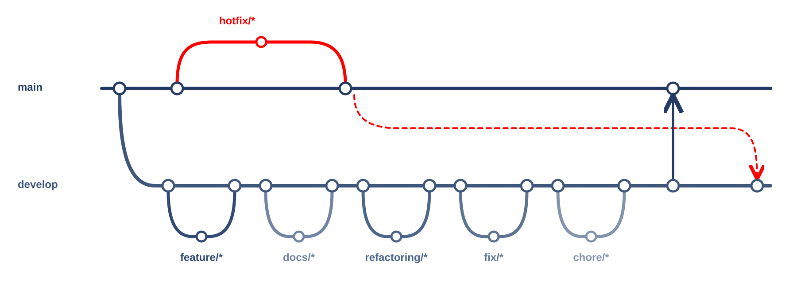

# 캠퍼스 위치 보정 모델

서경대학교 캠퍼스 길찾기 앱이 기기 안에서 쓰는 위치 보정 모델입니다.

## 개발 목적

실내·건물 사이에서 크게 튀는 휴대폰 GPS(특히 iPhone)를 그대로 쓰지 않고, 이미 만든 캠퍼스 통로·건물·층으로 위치가 끌려가도록 보정합니다.
GPS·걸음·기압을 함께 써서 통로를 따라 움직이고, 층은 계단·승강기로만 바뀌게 합니다.

## 사용 도구

| 구분 | 도구 |
|---|---|
| 학습·평가 | Python, uv, NumPy, scikit-learn, pyproj |
| 모델 내보내기 | ONNX, skl2onnx, onnxruntime, 순수 TS 용 JSON |
| 기기 실행 | TypeScript(Hermes 호환), vitest |
| 자료 | 지도 꾸러미(캠퍼스 백엔드), 합성 동선, 실제 세션의 집계 통계 |

## 브랜치와 PR

- `main`: 배포용. 일반 변경은 PR로 병합.
- `develop`: 개발 통합용.
- `feature/*`, `docs/*`, `refactoring/*`, `fix/*`, `chore/*`: `develop`에서 분기 → 작업·검증 → PR → `develop` 병합.
- 배포 준비 완료 후 `develop` → `main` PR.
- `hotfix/*`: `main`에서 분기 → 검증 → PR 없이 `main` 병합·push. 같은 수정을 `develop`에도 반영.

PR은 목적·변경·확인·배포/후속을 각각 한 줄로 적습니다. 미검증은 이유를 적고, 배포 영향이나 후속 작업이 없으면 `없음`을 적습니다.

실행 방법과 개발 세부 내용은 [개발 가이드](docs/개발-가이드.md)에 있습니다.
